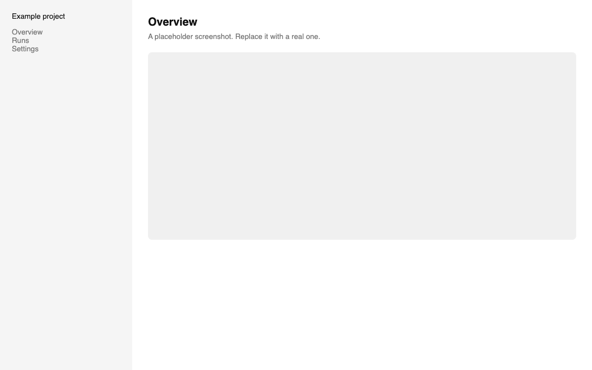

# Example project

A one-paragraph summary goes here, in plain sentences. The portfolio shows the first paragraph of this README as the project overview, so say what the project does and why it exists before anything else.

## What the portfolio reads from this repo

- **Name:** the repository name.
- **Tagline:** the repository description (About, on the right of the repo page).
- **Demo button:** the Website field in the same About box. Set it once.
- **Overview:** the first paragraph above.
- **Gallery:** every image in this README, in order, up to six.
- **Status:** worked out from activity. A push in the last 30 days is Building. A release or a Website makes it Live. Otherwise it is shown as quiet.
- **Stack:** the languages GitHub detects.
- **Activity:** commits, published releases, and closed milestones.
- **Milestones:** the `milestones` list in `portfolio.json`. A milestone is done on the date of the first commit whose title contains all its words, and is shown as planned until then.
- **Writing:** a post with `project: example-project` in its front matter shows up on the project page.

## Optional

Put a `portfolio.json` at the root to override anything above. Every key is optional and the file can be left out. Add the topic `no-portfolio` to hide a repo.
